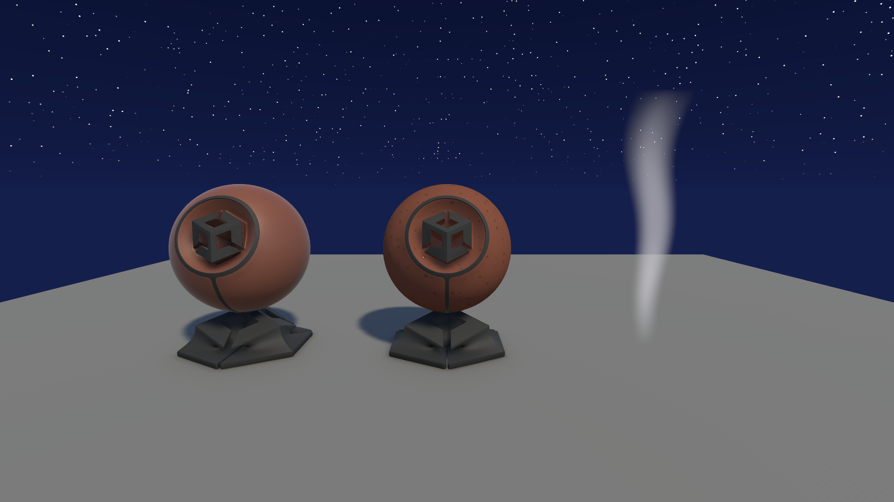
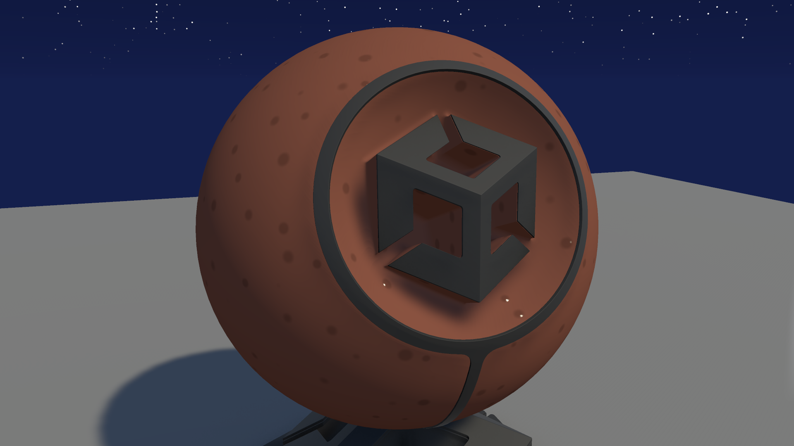
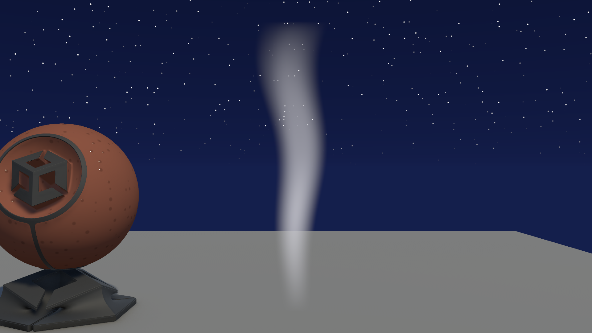

# SUBMISSION — 나만의 셰이더 제작

## 한눈에 보기

| # | 셰이더 | 분야 | 방식 | 보는 곳 |
| --- | --- | --- | --- | --- |
| 01 | [WetDroplets](#01-wetdroplets--물방울-맺힘) | 3D 오브젝트 | HLSL (`.shader`) | `ShaderBall_2` (비교용: 같은 색의 URP Lit `ShaderBall_1`) |
| 02 | [NightSky](#02-nightsky--밤하늘) | 스카이박스 | HLSL (`.shader`) | `MyShader_김진우` 씬의 하늘 (Skybox Material) |
| 03 | [Smoke](#03-smoke--연기) | 이펙트 | HLSL (`.shader`) | `Smoke` Quad (`ShaderBall_2` 오른쪽) |

---

## 01. WetDroplets — 물방울 맺힘

- 파일: `Assets/02. MyShaders/01_WetDroplets/WetDroplets.shader`, `WetDroplets.mat`
- 비교용: `WetDroplets_Compare.mat` (같은 바탕 색의 URP Lit). `ShaderBall_1` 에 넣어 셰이더만 다를 때의 차이를 보여 준다.
- 한 줄 설명: 표면에 물방울이 맺혀 젖은 자국이 생기고, 햇빛에 반짝인다.

### 동작 원리

1. **칸 나누기**: 월드 위치에 `Droplet Density` 를 곱하고 `floor` 로 3D 칸 번호를 구한다. 칸 번호를 해시 함수에 넣어 칸마다 다른 0~1 랜덤 값을 얻는다.
2. **물방울 놓기**: 칸 가운데쯤에 작은 공(물방울) 하나를 놓는다. 표면이 그 공을 지나가는 곳이 물방울로 보인다. 공까지의 거리로 `1 − smoothstep` 마스크를 만들어 물방울 안은 1, 밖은 0 으로 하고, 가장자리는 부드럽게 한다. 랜덤 값으로 물방울 크기와 있을지 없을지(`Droplet Coverage`)를 정한다.
3. **물방울 법선**: 물방울 가운데에서 바깥쪽으로 갈수록 법선을 바깥으로 기울인다. 그래서 물방울이 볼록한 렌즈처럼 빛을 받는다.
4. **바탕 조명**: `법선 · 빛 방향` 으로 빛을 받는 정도를 구하고, 주변광(`SampleSH`)을 더해 바탕을 칠한다. 주 광원의 그림자도 받는다. 물방울이 있는 곳은 `Droplet Darkening` 만큼 어둡게 해서 젖은 자국처럼 보이게 한다.
5. **햇빛 반짝임**: 물방울 법선으로 블린-퐁 하이라이트(`pow(법선 · 하프 벡터, 256)`)를 계산해 바탕 위에 더한다. 그림자 값과 빛을 받는 정도를 곱해, 그림자 속이나 빛을 등진 면의 물방울은 반짝이지 않는다.

그림자와 깊이 패스는 URP 기본 Lit 셰이더의 패스를 `UsePass` 로 빌려 쓴다.

### 프로퍼티

| 프로퍼티 | 하는 일 | 범위 |
| --- | --- | --- |
| Base Color | 바탕 색 | 색 |
| Droplet Density | 1 미터당 칸 수. 클수록 물방울이 작고 촘촘해진다 | 2 ~ 60 |
| Droplet Size | 칸 크기 대비 물방울 반지름 | 0.05 ~ 0.3 |
| Droplet Coverage | 물방울이 들어 있는 칸의 비율 | 0 ~ 1 |
| Droplet Darkening | 물방울 아래 바탕을 어둡게 하는 정도 | 0 ~ 1 |
| Droplet Glint | 햇빛 반짝임 세기 | 0 ~ 10 |

---

## 02. NightSky — 밤하늘

- 파일: `Assets/02. MyShaders/02_NightSky/NightSky.shader`, `NightSky.mat`
- 쓰는 곳: `MyShader_김진우` 씬의 Lighting > Environment > Skybox Material
- 한 줄 설명: 남색 그라데이션 하늘에 별이 제각각 반짝인다.

### 동작 원리

1. **하늘 방향**: 스카이박스 메시의 정점 위치를 그대로 "하늘을 바라보는 방향"으로 쓴다. 정규화하면 위는 y = 1, 수평선은 y = 0, 아래는 y = −1 이다.
2. **하늘 그라데이션**: 방향의 높이로 수평선 색과 꼭대기 색을 섞는다(`sqrt` 를 써서 수평선 근처에서 색이 빨리 바뀐다). 수평선 아래는 수평선 색 그대로 둔다.
3. **별 놓기**: 방향에 `Star Density` 를 곱하고 `floor` 로 3D 칸 번호를 구한다. 칸 번호를 해시 함수에 넣어 이 칸에 별이 있을지(`Star Amount`)와 별의 자리를 정하고, 별까지의 거리로 작은 점을 그린다. 수평선 아래에는 별을 그리지 않는다.
4. **반짝임**: 별마다 해시 값으로 정한 속도와 시작점으로 `sin` 을 돌려 밝기가 10% ~ 100% 사이에서 오르내린다(`0.55 + 0.45 × sin`).

### 프로퍼티

| 프로퍼티 | 하는 일 | 범위 |
| --- | --- | --- |
| Top Color | 하늘 꼭대기 색 | 색 |
| Horizon Color | 수평선 근처 하늘 색 | 색 |
| Star Density | 하늘을 나누는 칸 수. 클수록 별이 작고 촘촘하다 | 20 ~ 300 |
| Star Amount | 별이 들어 있는 칸의 비율 | 0 ~ 1 |
| Star Size | 칸 크기 대비 별 크기 | 0.02 ~ 0.25 |
| Star Brightness | 별 밝기 | 0 ~ 10 |
| Twinkle Speed | 반짝이는 속도 | 0 ~ 10 |

---

## 03. Smoke — 연기

- 파일: `Assets/02. MyShaders/03_Smoke/Smoke.shader`, `Smoke.mat`
- 한 줄 설명: 밑에서 위로 아지랑이처럼 sin 파 모양으로 일렁이며 피어오르는 연기.

### 동작 원리

Quad 의 UV 아래(y = 0)를 바닥, 위(y = 1)를 꼭대기로 본다.

1. **sin 파 흔들림**: `sin(높이 × Wave Frequency × 2π − 시간 × Wave Speed)` 로 연기를 좌우로 흔든다. 시간을 빼기 때문에 물결 모양이 위로 흘러가고, 높이(uv.y)를 곱해 위로 갈수록 크게 흔들린다.
2. **피어오르는 노이즈**: 값 노이즈 2 겹을 더하고, 세로 좌표에서 `시간 × Rise Speed` 를 빼서 무늬가 위로 올라가게 한다. 세로 좌표에 0.4 를 곱해 노이즈를 위아래로 늘였기 때문에 연기 결이 길게 보인다.
3. **연기 기둥 모양**: 흔들린 가운데 선에서 멀수록 옅게 한다(`1 − smoothstep(0, 폭, 거리)`). 폭은 위로 갈수록 넓어진다. `sin(높이 × π)` 를 곱해 바닥과 꼭대기에서는 0, 가운데에서는 1 이 되게 해서 아래위 끝이 서서히 옅어진다. Quad 의 좌우 끝 10% 에서도 옅어져서 흔들림이 커도 연기가 일자로 잘리지 않는다.
4. **색과 투명도**: 연기 색 한 가지로 칠하고, 기둥 모양 × 노이즈 값에 `Opacity` 와 연기 색의 알파를 곱해 투명도로 쓴다(알파 블렌딩).

### 프로퍼티

| 프로퍼티 | 하는 일 | 범위 |
| --- | --- | --- |
| Smoke Color | 연기 색. 알파 값은 불투명도에 곱해진다 | 색 |
| Opacity | 전체 불투명도 | 0 ~ 1 |
| Rise Speed | 연기 무늬가 위로 올라가는 속도 | 0 ~ 2 |
| Noise Scale | 연기 결의 크기. 클수록 잘게 갈라진다 | 1 ~ 10 |
| Column Width | 연기 기둥의 굵기 | 0.05 ~ 0.5 |
| Wave Amplitude | sin 파 흔들림 폭 | 0 ~ 0.3 |
| Wave Frequency | 높이 방향 물결 개수 | 0 ~ 5 |
| Wave Speed | 물결이 위로 흘러가는 속도 | 0 ~ 10 |
